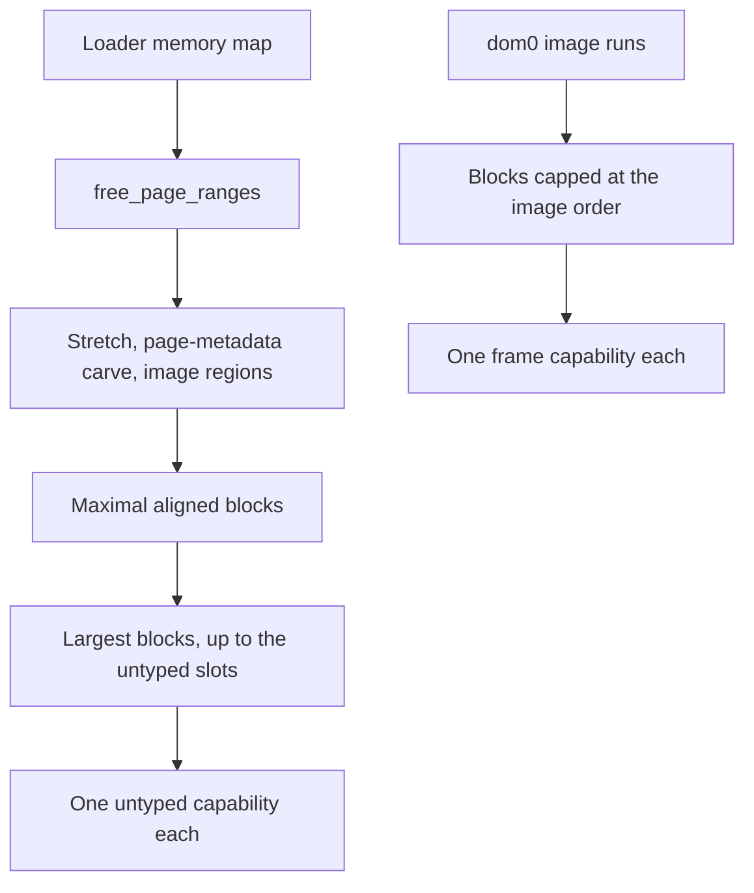

# How does boot cover all free memory in a bounded number of untyped capabilities?

Boot is when the kernel hands memory out. Afterwards a process reaches a page through a capability the root holds, or through one derived from those, and the kernel allocates nothing further (`design/untyped-memory/`, `kernel_init` in `kernel/verified/capability/boot_kernel.rs`). Free memory fits in the root's fixed table because each untyped capability names one aligned block of 2^order pages (`design/capability-names-a-block/`, `payload_wf` in `kernel/verified/capability/table.rs`; `design/root-process-at-boot/`).

## The map is checked, then what boot keeps is set aside

The loader passes the firmware map's free physical runs. They cross the trust boundary in `boot` of `kernel/src/capability.rs`. `free_page_ranges` in `kernel/src/boot/free_ranges.rs` folds them and panics, naming the address, when a range is empty, is not aligned to a page of {{PAGE_SZ:,}} bytes, runs past the node space, is RAM past the identity-mapped span, overlaps another range, or is available inside the kernel image or dom0's reserved range. `kernel/src/boot/mod.rs` holds that page equal to `PAGE_SZ`. Pages past the ones the kernel tracks are left unused. The check is tier 3 (`design/trust-boundary/`).

dom0's loaded runs are checked by `mapped_runs` in `kernel/src/boot/mapped_runs.rs`. A run that is empty, is not aligned to that page, sits outside dom0's reservation, falls in the low entries a process space keeps for the kernel, leaves the user half, or overlaps another run's physical or virtual pages is a boot panic.

The pages boot keeps are ones no untyped covers (`design/root-process-at-boot/`). `aligned_stretch` in `kernel/src/capability.rs` takes the lowest free run that is long enough, and aligned, for the root's process, its table leaves, its thread, the list's synthetic root and the capability kernel, and that stretch is set aside. `carve` in `kernel/src/boot/free_ranges.rs` places the page-metadata carve at the lowest available address that holds it clear of the kernel image, dom0's reservation and dom0's regions (`design/page-metadata-sized-from-the-memory-map/`). Every 2M region a page of dom0's image lies in is set aside as well. `free_page_ranges` runs again with the stretch taken, and the runs that remain are what the root can receive.

## A free run becomes maximal aligned blocks

`order_below` and `run_blocks` in `kernel/verified/capability/decompose.rs` are the rule, and `first_block` runs it. From the run's first page, take the largest order at most `MAX_ORDER` ({{MAX_ORDER}}, in `kernel/verified/capability/table.rs`) that the page is aligned to and that the pages still in the run hold. That block is one capability. The same step then starts at the page after the block. A block of order k names 2^k pages, and its base is aligned to its size (`payload_wf`).

`lemma_run_blocks` in the same file ensures that a run lying inside the pages the block table tracks, decomposed at `MAX_ORDER`, has at most {{BLOCKS_PER_RUN}} blocks. The first leaf holds {{ROOT_UNTYPED_SLOTS}} untyped slots, so one such run fits in the leaf. `runs_blocks` concatenates the runs, and several runs together can pass that slot count.

This run of {{EXAMPLE_PAGES}} pages at page {{EXAMPLE_START}} is an illustration, in page units, not a machine's map. `tools/faq.py` computes the blocks by the rule above.

{{decompose:run}}

Page {{EXAMPLE_START}} is aligned to no order above {{EXAMPLE_BLOCK0_ORDER}}, so the first block is that order, at page {{EXAMPLE_BLOCK0_PAGE}}. The next block, at page {{EXAMPLE_BLOCK1_PAGE}}, is order {{EXAMPLE_BLOCK1_ORDER}}, the largest that both the alignment and the pages still left allow. The last, at page {{EXAMPLE_BLOCK2_PAGE}}, is order {{EXAMPLE_BLOCK2_ORDER}} and takes the pages that remain. Those {{EXAMPLE_BLOCKS}} blocks cover the run.

## The largest blocks take the untyped slots

The untyped sit in the root's first leaf. `ROOT_UNTYPED_SLOT` in `kernel/verified/capability/boot.rs` is slot {{ROOT_UNTYPED_SLOT}}, past the root's process, thread, console, power and core capabilities. `ROOT_UNTYPED_SLOTS` in `kernel/verified/capability/boot_memory.rs` is {{ROOT_UNTYPED_SLOTS}}: the slots from there through slot {{UNTYPED_LAST_SLOT}}, the leaf's last. A leaf's first node is its hidden node, so the leaf has {{LEAF_SLOTS}} slots (`kernel/verified/capability/table.rs`). The untyped are the slots those earlier capabilities leave.

`largest_blocks` in `kernel/src/capability.rs` decomposes every remaining run and writes the largest blocks, largest order first and, within an order, in the order they were found, at most {{ROOT_UNTYPED_SLOTS}} of them. Each kept block is handed on as a run of exactly its own pages (`1 << order` pages, starting on a page aligned to that order), so decomposing that run again yields that one block. The smaller blocks stay unused, and the memory left out is the fragments at the edges of runs (`design/root-process-at-boot/`). The first kept block is the largest. Its order-{{TABLE_ORDER}} pieces are the size of a table page (`TABLE_PAGE_BYTES` in `kernel/verified/capability/space.rs`), and `untyped_tables` in `kernel/verified/capability/boot_table.rs` counts them. Those pieces pay for the root's page tables.

`boot_root_memory` in `kernel/verified/capability/boot_memory.rs` places one untyped capability per block of the runs it is given, at consecutive slots from `ROOT_UNTYPED_SLOT`, by `boot_root_untyped`. The rights on each are retype alone (`UNTYPED_RIGHTS` in `kernel/verified/capability/boot.rs`). When the runs decompose into more blocks than `ROOT_UNTYPED_SLOTS`, `boot_root_memory` returns nothing and leaves the state as it stood at that step. `kernel_init` returns nothing when the free runs make no block, or more blocks than `ROOT_UNTYPED_SLOTS`, or when dom0's image does not fit, as the next section says. `boot` then panics with "the capability kernel refused the boot memory or dom0's runs". `largest_blocks` is what keeps the list a real boot hands inside the slots. The refusal is what the verified step does with a list that is empty or too long.

The runs below are the same kind of illustration, again computed by `tools/faq.py`. There are {{OVERFLOW_RUNS}} of them, one per untyped slot, each {{OVERFLOW_PAGES}} pages. The first starts at page {{OVERFLOW_ORIGIN}}, and each later run starts {{OVERFLOW_STRIDE}} pages further on. Each run splits into a block of order {{OVERFLOW_SMALL_ORDER}} and a block of order {{OVERFLOW_LARGE_ORDER}}. Together the runs are {{OVERFLOW_BLOCKS}} blocks.

{{decompose:overflow}}

The {{OVERFLOW_KEPT}} blocks that are kept are the largest. The {{OVERFLOW_LEFT}} left unused are {{OVERFLOW_PAGES_LEFT}} pages.

## dom0's image arrives as frame capabilities

The image's pages are reserved, so no untyped covers them (`design/root-process-at-boot/`). `image_blocks` in `kernel/verified/capability/boot_image.rs` decomposes each loaded run by the same rule, capped at `IMAGE_ORDER` ({{IMAGE_ORDER}}). A block is then at most {{IMAGE_PAGES}} pages. That cap is what keeps the block inside one 2M region, and `boot_root_frame` types the region as a large frame. Each block becomes one frame capability. `image_rights` gives it read, plus write and execute as the loader mapped the run, and `boot_root_frame` carries no control right.

The frames sit in the root's second leaf, from `ROOT_FRAME_SLOT` ({{ROOT_FRAME_SLOT}}), the slot after that leaf's hidden node, through slot {{FRAME_LAST_SLOT}}: {{ROOT_FRAME_SLOTS}} slots (`ROOT_FRAME_SLOTS` in `kernel/verified/capability/boot_image.rs`). `boot_root_image` returns nothing when the blocks do not fit that leaf.

`kernel_init` also returns nothing when a run's virtual pages do not all lie under level-4 entries past the kernel's (`image_virt_wf` in `kernel/verified/capability/boot_table.rs`), or when the tables the runs need exceed the order-{{TABLE_ORDER}} blocks of the first untyped (`image_tables_bound` and `untyped_tables`). Before it writes a table, `boot_root_tables` retypes those blocks from the untyped at `ROOT_UNTYPED_SLOT` and links them through the root's process capability: the level-3, level-2 and level-1 table of each 2M region a run touches (`design/root-process-at-boot/`, `design/address-spaces-as-objects/`).
