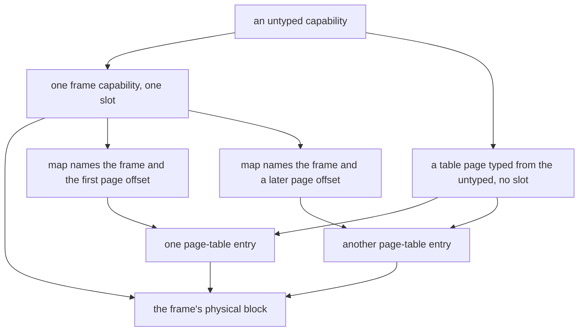

# How one frame capability backs many mappings

A frame capability names one block, and mapping it names that capability and a page offset inside the block. Each call writes one page-table entry. The entry is where the per-page state lives, so a mapping takes no capability slot. `design/capability-names-a-block/`.

## What one call writes

`CapKernel::map_at` in `kernel/verified/capability/map.rs` is the call, and `invoke_map` in `kernel/verified/capability/operation.rs` is the syscall. It passes the slot, the virtual address, the level, the frame's index and the page offset to `map_at`, in that order, which `spec_mapped` names. `design/syscall-abi-in-registers/` records the same positions on the map row: the space, the virtual address, the level, the frame and the page offset.

The slot is the capability that may write the space. `may_write_space` in `kernel/verified/capability/link.rs` accepts a process capability with the control right, because a process's space is part of the process (`design/process-holds-capabilities/`). `map` and `map_large` then require the space at that capability's base to be a process space.

`map_at` splits the address with `address_indices` and refuses an address `entry_named` refuses. `table_step` refuses a kernel slot through `is_kernel_slot` in `link.rs`, which is the record's refusal of an address in the root entries a process space keeps for the kernel. `map_at` accepts two levels, which the source writes as literals. `entry_span` gives the lower as {{PAGE_SZ:,}} bytes, and `map` writes the one page at the offset into an empty entry. It gives the next as {{SIZE_2M:,}} bytes, and `map_large` writes the {{PAGES_PER_2M}} pages at an offset that is a multiple of {{PAGES_PER_2M}}. A level whose `entry_span` is {{SIZE_1G:,}} bytes is neither of those literals, so `map_at` returns without writing. There is no mapping of a whole block of {{SIZE_1G:,}} bytes. `map` and `map_large` leave the kernel unchanged when they refuse.

The frame is an index in the caller's own table. `can_map` requires a live frame capability with the read right, and an offset whose bytes lie inside the block, `(page as int) * PAGE_SZ < block_bytes(order)`. `frame_of` is that page, the block's base page plus the offset, and `frame_map_entry` writes its address into the entry. The node the map adds is a mapping, a child of the frame capability. `map_written` leaves the capability tables as they were, and `is_cap` in `kernel/verified/capability/table.rs` counts only a live capability, so the node is not a slot. `lemma_mapping_node_place` in `kernel/verified/capability/mapping.rs` places the node inside the table page's own block. The call adds one reference on the block the page lies in, and `holders_wf` in `kernel/verified/capability/refs.rs` counts that node as a holder of the block (`design/teardown-driven-by-retype/`). Once the arguments are accepted, `map_frame` refuses only when the block is at the reference limit, and then changes nothing.

The same offset can be written into another empty entry, and each call adds its own reference. A different offset is a different page of the same block. Every such entry is another mapping, and the frame's slot is still the one slot.

## How many mappings one frame backs

The pages of a frame are its block. `block_bytes` in `kernel/verified/capability/table.rs` is one page shifted by the order, and `payload_wf` keeps the base aligned to that size. `design/capability-names-a-block/`. The mappings of one page are the offsets `can_map` admits, one per page of the block. The mappings of {{SIZE_2M:,}} bytes are the offsets `can_map_large` admits, and it admits an order only when the source's literal is {{INDEX_BITS}} or {{ONE_G_ORDER}}.

A frame of one page is {{PAGE_SZ:,}} bytes (`PAGE_SZ` in `kernel/verified/define.rs`). `can_retype_frame` in `kernel/verified/capability/retype.rs` allows it, and the `RETYPE_FRAME` arm of `allows_retype` is how a caller asks for it. The source writes that order as a literal. One offset lies inside one page, so the frame backs one mapping of {{PAGE_SZ:,}} bytes. Its order is neither of the literals `can_map_large` accepts, so the frame backs no mapping of {{SIZE_2M:,}} bytes.

A frame of {{SIZE_2M:,}} bytes has order {{INDEX_BITS}} (`INDEX_BITS` and `SIZE_2M` in `kernel/verified/define.rs`). `lemma_shifts` proves `ENTRIES` is the shift that order names, and `PAGES_PER_2M` is `ENTRIES`, so the block is {{PAGES_PER_2M}} pages. The `RETYPE_LARGE_FRAME` arm of `allows_retype` passes that order, and the source writes it as a literal. Every offset below the block can be a mapping of {{PAGE_SZ:,}} bytes, so the frame backs {{PAGES_PER_2M}} of them. A mapping of {{SIZE_2M:,}} bytes needs a multiple of {{PAGES_PER_2M}} that still has {{PAGES_PER_2M}} pages after it. One such offset fits, the start of the block, so the frame backs one mapping of {{SIZE_2M:,}} bytes.

A frame of {{SIZE_1G:,}} bytes has order {{ONE_G_ORDER}}, twice `INDEX_BITS` (`SIZE_1G` in `kernel/verified/define.rs`). The block is {{PAGES_PER_1G:,}} pages (`PAGES_PER_1G`, `ENTRIES` times `ENTRIES`). `can_retype_large` and `can_map_large` accept this order, and the source writes it as a literal. `allows_retype` does not pass it, so a caller cannot retype the frame, and `design/capability-names-a-block/` leaves a mapping of the whole block until the page table writes one. Were the frame held, `can_map` would admit {{PAGES_PER_1G:,}} mappings of {{PAGE_SZ:,}} bytes, and `can_map_large` would admit {{ENTRIES}} mappings of {{SIZE_2M:,}} bytes, one for each {{PAGES_PER_2M}} pages of the block.

| Frame | Order | Mappings of {{PAGE_SZ:,}} bytes | Mappings of {{SIZE_2M:,}} bytes |
| --- | --- | --- | --- |
| one page | the order `can_retype_frame` names | one | none |
| {{SIZE_2M:,}} bytes | {{INDEX_BITS}} | {{PAGES_PER_2M}} | one |
| {{SIZE_1G:,}} bytes | {{ONE_G_ORDER}} | {{PAGES_PER_1G:,}} | {{ENTRIES}} |

The last row is what map admits. Retype through the syscall does not produce that frame.

A frame whose order is neither literal backs as many mappings of one page as it has pages, and no mapping of {{SIZE_2M:,}} bytes. That includes a block that `image_blocks` in `kernel/verified/capability/boot_image.rs` cuts below its cap of order {{IMAGE_ORDER}}, and a child that `block_within` in `kernel/verified/capability/derive.rs` derives at a lower order. `design/sharing-by-derive/` is why that child takes a slot of its own. Mapping by offset inside the frame already held spends no slot. Deriving the piece spends one.

## The page table holds no slot

Whoever maps pays for the table pages out of an untyped. `design/address-spaces-as-objects/`. `CapKernel::retype_table_page` in `kernel/verified/capability/space.rs` types a block of {{TABLE_PAGE_BYTES:,}} bytes, order {{TABLE_ORDER}} (`TABLE_PAGE_BYTES` in `space.rs`). The source writes that order as a literal, and the body shows that literal's byte size equal to `TABLE_PAGE_BYTES`. It takes the untyped's index, a base and a level, and no destination slot, and it refuses a level outside the range the source writes as literals. `table_page_retype_done` leaves the capability tables as they were. The new node is hidden, a child of the untyped, and `is_cap` does not count it. The page starts empty, and no space maps it yet. `link_at` in `map.rs` writes it into the space. The untyped and the page's base are the positions `spec_linked` names, which `design/syscall-abi-in-registers/` records on the link row. A map writes an entry of a table that is already linked, and the entry's mapping node stays in the table page's block.

One slot reaches every entry, and each entry names a page of the block. The table page is not a slot, and neither is an entry.
