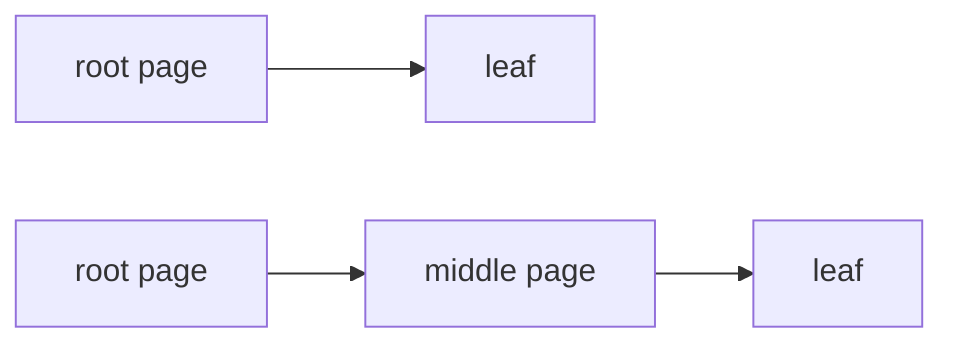

# Growing the capability table, and what each way costs

A process holds its capabilities in a table of two fixed levels (`design/process-holds-capabilities/`). The root is the first page of the process block, `TableRoot` in `kernel/verified/capability/table.rs`, and the record is the next page, `PROCESS_RECORD_PAGE` in `kernel/verified/capability/process.rs`. The root holds {{ROOT_ENTRIES}} pointers (`ROOT_ENTRIES`, equal to `ENTRIES`). A leaf is a block of {{LEAF_BYTES:,}} bytes (`LEAF_BYTES`), {{LEAF_PAGES}} pages: a node page and a payload page, retyped on demand. The first node of a leaf is its hidden node, so `index_ok` excludes it and a leaf has {{LEAF_SLOTS}} slots, `NODES_PER_PAGE` minus one in `kernel/verified/capability/list.rs`. A full table, a leaf at every root entry, holds {{TABLE_SLOTS:,}} slots. Those leaves are {{TABLE_BYTES:,}} bytes. The root page is not added: it is already part of the process block. The smallest table that holds a slot is one leaf.

`Tables::lookup` finds a slot in a fixed number of loads. It loads the root, takes the leaf pointer from it, loads the leaf's hidden node with `list.get` on the leaf, and loads the payload page. `index_entry` and `index_slot` split the index by `NODES_PER_PAGE`. The design's constant time is this fixed depth: there is no tree walk.

No capability names a table. `CapKind` has no table kind, and the design rejects a table as a capability because a table reachable from itself makes delete cascade. Revoke and delete do not walk tables. They walk the depth-first list (`design/revoke-by-depth-first-list/`). `CapKernel::delete` in `kernel/verified/capability/delete.rs` unlinks a node that has no children, and a node's descendants are the run after it with greater depth. A leaf is a block no capability names. `retype_leaf` in `kernel/verified/capability/retype.rs` makes the first node of its first page a hidden node, a child of the untyped, so revoking that untyped reaches the leaf (`design/teardown-driven-by-retype/`). The root is inside the process object and goes only with the process.

A position word puts the index in its low field. `POSITION_INDEX_MASK` in `kernel/verified/capability/position.rs` admits {{INDEX_FIELD_COUNT:,}} indices, and that field is {{INDEX_FIELD_BITS}} bits. `TABLE_INDICES` is {{TABLE_INDICES:,}}, so today's table fills the field. `design/syscall-abi-in-registers/`. The next field starts at bit {{POSITION_THROUGH_SHIFT}} and names which table the index is in, and a bit at {{POSITION_WIDTH}} or above is refused. Each index count below is past {{INDEX_FIELD_COUNT:,}}, so each way needs a wider index field before a caller can name the slot.

| Way | Slots | Smallest, bytes | Full, bytes | Indices |
| --- | --- | --- | --- | --- |
| Today | {{TABLE_SLOTS:,}} | {{LEAF_BYTES:,}} | {{TABLE_BYTES:,}} | {{TABLE_INDICES:,}} |
| More root pages | {{ROOTS_SLOTS:,}} | {{LEAF_BYTES:,}} | {{ROOTS_FULL:,}} | {{ROOTS_INDICES:,}} |
| Doubled leaf | {{DOUBLE_TABLE_SLOTS:,}} | {{DOUBLE_LEAF_BYTES:,}} | {{DOUBLE_FULL:,}} | {{DOUBLE_INDICES:,}} |
| Large-page leaf | {{BIG_TABLE_SLOTS:,}} | {{BIG_LEAF_BYTES:,}} | {{BIG_FULL:,}} | {{BIG_INDICES:,}} |
| Third level | {{THIRD_SLOTS:,}} | {{THIRD_SMALLEST:,}} | {{THIRD_FULL:,}} | {{THIRD_INDICES:,}} |

## More root pages

The address space starts at page {{SPACE_ROOT_PAGE}} of the process block, `SPACE_ROOT_PAGE` in `kernel/verified/capability/space.rs`. `spare_kept` in `process.rs` keeps each page after the record and before that one: {{SPARE_PAGES}} pages. They are already inside the block of {{PROCESS_BYTES:,}} bytes, order {{PROCESS_ORDER}} (`PROCESS_ORDER`). Using them as root pages gives {{ROOT_PAGES}} root pages, each of {{ROOT_ENTRIES}} pointers, and leaves stay {{LEAF_BYTES:,}} bytes. A sparse process pays nothing more, because those pages are ones the block already keeps, and the smallest table that holds a slot stays one leaf. A full table is the leaves only. The root pages are not added again.

Lookup does the loads `lookup` does now. The root page is the process base, and each spare page is the base plus that page's index times {{PAGE_SZ:,}} bytes, which is the address `spare_kept` states. The record sits between them, so the root pages are not a contiguous run, and choosing which of them the index names is still arithmetic on those addresses, not another load.

The spare pages are pages of the process, as the root is, and no capability names them. A leaf is unchanged, so its hidden node is still the untyped's child. Revoke and delete still walk the same list. Nothing in the growth is a capability for a table.

## Larger leaves

A leaf of twice the pages is {{DOUBLE_PAGES}} pages, {{DOUBLE_NODE_PAGES}} node pages and {{DOUBLE_NODE_PAGES}} payload pages. `small_order` in `kernel/verified/capability/block.rs` admits three orders, and `order_pages` sizes them to one page, to {{LEAF_PAGES}} pages and to {{PROCESS_PAGES}} pages. {{DOUBLE_PAGES}} is none of those, so this leaf is not a block retype makes today. It would be a new order. The first node of the leaf stays the one hidden node, so the leaf has {{DOUBLE_SLOTS_PER}} slots out of {{DOUBLE_NODES}} nodes. Over the {{ROOT_ENTRIES}} root entries that is the slot count in the table. The smallest table that holds a slot is the whole leaf, {{DOUBLE_LEAF_BYTES:,}} bytes.

A leaf whose pages are {{SIZE_2M:,}} bytes (`SIZE_2M` in `kernel/verified/define.rs`) is the other size. A node page holds {{NODES_PER_PAGE}} nodes in {{PAGE_SZ:,}} bytes, and `Payload` is that same size, so one page of {{SIZE_2M:,}} bytes holds {{BIG_NODES:,}} of either. One hidden node leaves {{BIG_SLOTS_PER:,}} slots. The leaf is still one node page and one payload page, {{BIG_LEAF_BYTES:,}} bytes, and that is the smallest table that holds a slot. Each page is then the size of a large block. A large block cannot write its page entries in a bounded step, so `block.rs` keeps its state in its region entry. The pair of pages is not a size the block table has: a small block stops at {{PROCESS_PAGES}} pages, and a large block is one region of {{SIZE_2M:,}} bytes or one of {{SIZE_1G:,}} bytes.

The doubled leaf is one block a root entry points at, as a leaf is now. The large-page leaf keeps that shape, one node page and one payload page. `lookup` still loads the one leaf's hidden node and its payload, so the levels do not change. What changes is the split of the index, which follows the leaf's node count instead of `NODES_PER_PAGE`. Either leaf stays a block no capability names. The hidden node stays the first node of the first page, a child of the untyped, which is what `retype_leaf` does and what `design/teardown-driven-by-retype/` requires of a block no capability names. Revoke reaches the leaf the same way, and delete is still an unlink on the list.

## A third level

A page of {{ENTRIES}} pointers between the root and the leaf gives the third level. `ENTRIES` pointers fill one page, and `TableRoot` is that page, so a middle page is the same shape as the root. {{ROOT_ENTRIES}} middle pages, each with {{ENTRIES}} leaves of {{LEAF_SLOTS}} slots, are the slot count in the table. One middle page covers {{TABLE_SLOTS:,}} slots, a full table of today, in {{PAGE_SZ:,}} bytes. The smallest table that holds a slot is one middle page plus one leaf, {{THIRD_SMALLEST:,}} bytes. A full table is the leaves, {{THIRD_LEAVES_BYTES:,}} bytes, plus the middle pages, {{THIRD_MIDDLE_BYTES:,}} bytes.

The first chain is `lookup` today. The second loads the middle page between the root and the leaf: one more dependent load, and the depth is still fixed, which is the design's reason lookup stays constant time rather than becoming a walk.

A middle page is where a table would hold a table. The no-cycles argument does not depend on there being two levels. It depends on no capability naming a table. A middle page holds pointers, as `TableRoot.leaves` does, and a pointer is not a `Payload`. `CapKind` still has nothing that names it. For revoke to reach the page, it is a block no capability names, and the first node of its first node page is a hidden node, a child of the untyped it was retyped under. That is the rule `design/teardown-driven-by-retype/` already states for a table leaf and a table page. Delete still unlinks a childless node of the depth-first list, and the middle page is not a node of that list. Naming the middle page with a capability is the alternative the design rejects, and it is what would let a table be reachable from itself.

## What the capacities hold

The plot's columns are the rows above, on a logarithmic axis of slots. Under a column is the smallest table, the full table, and the memory one process reaches by putting one block in every slot: the smaller of the slots times the block and the address space, {{NODE_SPACE:,}} bytes (`NODE_SPACE` in `kernel/verified/capability/list.rs`). The blocks are a frame of {{PAGE_SZ:,}} bytes, a frame of {{SIZE_2M:,}} bytes and a block of {{SIZE_1G:,}} bytes (`design/capability-names-a-block/`). The same bound is what today's table is drawn against in the budget explainer.

