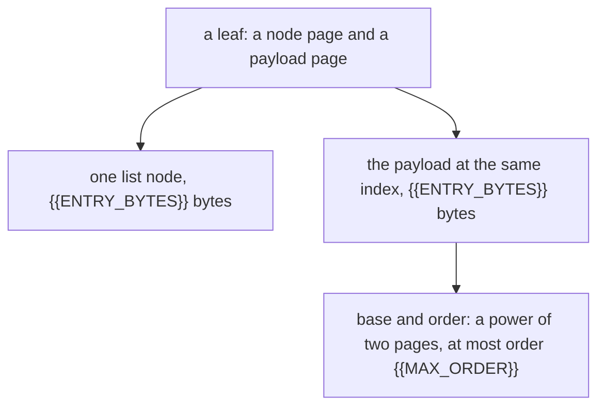

# How one capability slot names a block of pages

A process holds capabilities, and a thread holds none. The table is two fixed levels, and no capability names it. `design/process-holds-capabilities/`. One slot does not name one page. A capability that names memory names a block: a base aligned to the block's size, and a page count that is a power of two, the power being the capability's order. The table does not list those pages. `design/capability-names-a-block/`. `block_bytes` in `kernel/verified/capability/table.rs` is one page times a power of two, the power being the order, and `payload_wf` keeps the base aligned to that size and the block inside the address space.

## How many slots the table holds

The root is `TableRoot` in `table.rs`: {{ROOT_ENTRIES}} pointers, `ROOT_ENTRIES`, which is `ENTRIES` in `kernel/verified/define.rs`. It is the first page of the process. `Tables::put_root` writes every entry `NO_LEAF`, so a new table names no leaf and holds no slot. A leaf is a block of {{LEAF_BYTES:,}} bytes, `LEAF_BYTES`, which is {{LEAF_PAGES}} pages: a node page, then a payload page. The node page holds {{NODES_PER_PAGE}} list nodes, `NODES_PER_PAGE` in `kernel/verified/capability/list.rs`. The first of them is the leaf's hidden node, so `index_ok` excludes it and a leaf has {{LEAF_SLOTS}} slots. `TABLE_INDICES` is {{TABLE_INDICES:,}}, one leaf's nodes for each of the {{ROOT_ENTRIES}} root entries. `index_ok` admits an index below that whose position in its leaf is not the first node, so the table admits {{TABLE_SLOTS:,}} slots. The slots appear when a leaf is retyped into an empty root entry.

## What one slot holds

`Tables::lookup` splits an index with `index_entry` and `index_slot`, each dividing by `NODES_PER_PAGE`. It refuses an index at or above `TABLE_INDICES`, and a position that is the first node of its leaf. The node id is the leaf's address plus that position. `slot_node` names it, and `lookup` returns `leaf + slot` with the payload beside it. The payload is the entry at that same position, loaded from the page at `leaf + PAGE_SZ`.

The list node is `Node` in `list.rs`: `live`, `kind`, `depth`, `next` and `prev`. `kind` is `NodeKind`, and `next` and `prev` are the links of the depth-first list. The parent is not a field of the node. `Tree` keeps `parent` as a ghost map, for the proof, and a node's children are the run after it at greater depth. `design/revoke-by-depth-first-list/`. The payload is `Payload` in `table.rs`: `kind`, `order`, `rights`, `base`, `badge` and `priority`. `kind` is `CapKind`. `priority` is a core capability's maximum priority, and zero for every other kind.

`global layout NodePage` and `global layout PayloadPage` in `kernel/verified/layouts.rs` each give that page {{PAGE_SZ:,}} bytes. Each page holds `NODES_PER_PAGE` entries, so one entry is {{ENTRY_BYTES}} bytes. A slot is one node and the payload at the same index, on the leaf's {{LEAF_PAGES}} pages. The node's id is that index in the page, not a byte offset of {{ENTRY_BYTES}}: `Tree::valid` admits an id only when its index in the page is below `NODES_PER_PAGE`.

`names_block` is every kind except a device, the console, power and a core. Those name objects above the address space, so no memory capability covers them. `design/capability-names-a-block/`. For a kind `names_block` accepts, `cap_wf` requires `payload_wf`: the order is at most `MAX_ORDER`, the base is aligned to `block_bytes` of that order, and the base plus that many bytes ends at or before `NODE_SPACE`. An untyped and a frame are the kinds a narrower child can be cut from. The other kinds `names_block` accepts take the order their retype writes.

## The orders an untyped and a frame may take

An untyped may take any order up to `MAX_ORDER`, {{MAX_ORDER}}. `payload_wf` asks nothing else of the order. A child cut from it may take any lower order that still names a whole block inside it. `block_within` in `kernel/verified/capability/derive.rs` is that cut: the order at most the parent's, the base aligned to the child's size, and the child's block inside the parent's. `is_block_within` decides it in constant time, and when it accepts, the order is at most `MAX_ORDER`.

A frame retyped from an untyped takes a size the page table maps. `can_retype_frame` in `kernel/verified/capability/retype.rs` asks for one page, {{PAGE_SZ:,}} bytes, and the source writes that order as a literal. The `RETYPE_FRAME` arm of `allows_retype` in `kernel/verified/capability/operation.rs` is how a caller asks for it. `can_retype_large` accepts an order only when the source's literal is {{INDEX_BITS}} or {{ONE_G_ORDER}}. Order {{INDEX_BITS}}, `INDEX_BITS` in `kernel/verified/define.rs`, is {{SIZE_2M:,}} bytes, `SIZE_2M`. Order {{ONE_G_ORDER}}, twice `INDEX_BITS`, is {{SIZE_1G:,}} bytes, `SIZE_1G`. The `RETYPE_LARGE_FRAME` arm of `allows_retype` passes only order {{INDEX_BITS}}, and the source writes that order as a literal. `invoke_retype` passes that same literal to `retype_large_frame`. A caller retypes the block of {{SIZE_2M:,}} bytes and cannot retype the block of {{SIZE_1G:,}} bytes. The design leaves a frame of that larger size until the page table maps one.

A frame may also be derived at a lower order. `narrows` allows a smaller block only from an untyped or a frame, and `block_within` is that block. A child of a frame of {{SIZE_2M:,}} bytes can name any whole block of a lower order inside it, down to one page. The frame's slot stays the one slot.

The page metadata checks a block's freedom in one read at one page, at {{SIZE_2M:,}} bytes and at {{SIZE_1G:,}} bytes, which is why `can_retype_frame` and `can_retype_large` take those sizes and not an arbitrary order. `design/capability-names-a-block/` and `design/teardown-driven-by-retype/`. A range that is not a power of two was rejected, because the freedom check would no longer be constant time. Deriving the pieces of a larger frame, rather than one capability per page, keeps a pager's slot count proportional to what it has handed out.

## The largest order is the whole address space

`MAX_ORDER` in `table.rs` is {{MAX_ORDER}}. `NODE_SPACE` in `list.rs` is {{NODE_SPACE:,}} bytes, the end of the {{ADDRESS_BITS}}-bit space and one past its last byte. `order_bytes` in `derive.rs` is one page shifted left by the order, and it equals `block_bytes`. At `MAX_ORDER` that size is `NODE_SPACE`. `payload_wf` refuses an order above `MAX_ORDER` and a block that would end past `NODE_SPACE`. A payload of that order based at the start of the space names every byte the space holds, and `payload_wf` accepts it.

One slot names the block. The pages of the block are not entries of the table.
