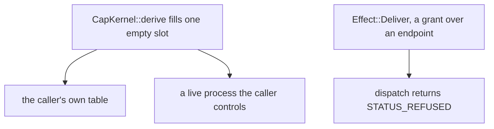

# What actually consumes capability slots

A process's capability table is pressured by the capabilities it holds, not by how much memory those capabilities cover. Mapping a frame by page offset and building a page table take no capability slot, so the slots that fill are grants, objects a process retypes, and frames a pager types before anything asks for them.

Boot fills the root process's table. `design/root-process-at-boot/` records what it places there, and `kernel/verified/capability/boot.rs` does it. What a process fills afterwards is below.

## What does not take a slot

A frame is mapped by naming the capability, a page offset and an address, so one capability covers every page of its block. That is `design/capability-names-a-block/`. `CapKernel::map_at` in `kernel/verified/capability/map.rs` writes one translation of the frame capability it is given: one page of {{PAGE_SZ:,}} bytes at the level that maps a single page, or {{PAGES_PER_2M}} pages ({{SIZE_2M:,}} bytes) at the level that maps a larger page. It takes no destination slot, and the node it adds is a mapping, which `is_cap` excludes. `lemma_mapping_node_place` in `kernel/verified/capability/mapping.rs` places that node inside the table page's own block.

A table page is paid for the same way. `design/address-spaces-as-objects/` makes whoever maps pay for it out of an untyped, and `CapKernel::retype_table_page` in `kernel/verified/capability/space.rs` takes that untyped's slot and a base, and no destination slot. `table_page_retype_done` leaves the capability tables as they were.

A leaf is how a table gains slots, and no capability names it. `design/process-holds-capabilities/`. The table is a root of {{ROOT_ENTRIES}} pointers, `ROOT_ENTRIES` in `kernel/verified/capability/table.rs`, and a leaf is a block of {{LEAF_BYTES:,}} bytes. `CapKernel::retype_leaf` in `kernel/verified/capability/retype.rs` puts the leaf in a root entry of the caller's table, or of a live process the caller controls. Its hidden node is a child of the untyped it was retyped under. A leaf's node page holds {{NODES_PER_PAGE}} nodes, `NODES_PER_PAGE` in `kernel/verified/capability/list.rs`, and the first of them is no slot, so a leaf has {{LEAF_SLOTS}} slots. `TABLE_INDICES` in `table.rs` is {{TABLE_INDICES:,}}, one leaf's nodes for each of the {{ROOT_ENTRIES}} root entries. `index_ok` admits an index below that whose `index_slot` is not the first node of its leaf, so the excluded indices are one per leaf and the table admits {{TABLE_SLOTS:,}} slots.

Mapping into a device space grants what that space maps to whoever can see the space, and still fills no slot. `design/device-binding-under-the-space-capability/`. `CapKernel::map_device` in `kernel/verified/capability/device_space.rs` does that map, and on success discharges `Effect::Share` in `kernel/verified/capability/reach.rs`. It writes the entry through `map_kind` or `map_large_kind`, the same writes `map_at` uses for a process space, and the node it adds is a mapping. `invoke_map` calls only `map_at`, so a process cannot make this grant through `dispatch`.

## Where a derived capability lands

Derive is the only way to share a capability, and the child occupies a slot wherever it is placed. `design/sharing-by-derive/`. `CapKernel::derive` in `kernel/verified/capability/derive.rs` fills one empty position. The position is `Position` in `kernel/verified/capability/position.rs`: an index of the caller's own table, or, through a process capability the caller holds with the control right, an index of that process's table. `find_table` does the lookup, and when the position names another process `derive` then refuses one that is dead. `find_destination` is that refusal as one lookup. The child stays a child of the capability it was derived from, in either table, so the deriver can revoke it. `narrows` and `block_within` keep the child's rights and block inside the parent's, which is how one frame derives a smaller piece and spends one slot for that piece.

A grant over an endpoint is the other place that record puts a child: in a slot the receiver named. The reach model is `Effect::Deliver` in `reach.rs`, a delivery through a rendezvous, beside `Effect::Place`, a grant through control by `derive` or by a move of the node itself. The syscall numbers that would run a delivery, `OPERATION_SEND`, `OPERATION_RECEIVE`, `OPERATION_CALL` and `OPERATION_REPLY_RECV` in `kernel/verified/capability/operation.rs`, match no arm of `CapKernel::dispatch`. The wildcard arm returns `STATUS_REFUSED` and leaves the kernel as it was, so that grant fills no slot. A server that does not hold control over its client keeps each derived child in its own table, one slot per grant.

`CapKernel::move_cap` in `kernel/verified/capability/moving.rs` fills the destination slot and empties the source. It adds no capability. A move into a controlled process's table is a placement of the node itself, and a move out of one is a claim, both as `design/sharing-by-derive/` describes them. The destination goes through `find_destination`, which refuses a dead process, so nothing is placed into a dead process's table. The source goes through `find_table`, which does not read whether the process is dead, so a claim from a dead process's table still succeeds. A source in the caller's own table is refused when `is_cap_dead` says the capability names a dead process or thread.

## Objects that take one slot each

Each retype below writes one capability into an empty index of the caller's own table. `retype_slots` in `kernel/verified/capability/retype.rs` looks that index up in the caller's table and refuses an index that does not name an empty slot. The untyped the block comes from is a slot the caller already holds. The new capability stays there: a later `derive` or `move_cap` is what puts a capability into another process's table. `design/thread-bound-at-retype/` records that choice for a thread, because the creator is who sets the thread's registers and starts it.

A thread is an order-{{THREAD_ORDER}} block, `THREAD_ORDER` in `kernel/verified/capability/thread.rs`, and `CapKernel::retype_thread` puts its control capability at that empty index. The thread holds no slots. `design/process-holds-capabilities/`. The first node of its node page is its process binding, and the next node is its placement. One thread is one slot, in the table of whoever retyped it.

A process is an order-{{PROCESS_ORDER}} block, `PROCESS_ORDER` in `kernel/verified/capability/process.rs`, and `CapKernel::retype_process` puts its control capability at that empty index. The new table holds no leaf, so the process holds nothing until a `retype_leaf` gives it slots. That retype creates slots. It does not spend one. The process's own address space is part of this retype.

An endpoint, a notification and a reply are each one page of {{PAGE_SZ:,}} bytes, and each retype puts a capability at an empty index: `CapKernel::retype_endpoint` and `CapKernel::retype_notification` in `kernel/verified/capability/endpoint.rs`, and `CapKernel::retype_reply` in `kernel/verified/capability/reply.rs`. Each of those checks `can_retype_block` at the order of a single page. `design/ipc-with-reply-object/` is why a reply is an object of its own rather than a field of the thread. A device space or a nested table is an order-{{PROCESS_ORDER}} block: `CapKernel::retype_space` in `kernel/verified/capability/space.rs` checks `can_retype_block` at that order, which the source writes as a literal, and `PROCESS_ORDER` is the same number. It puts the space's capability at an empty index. A process's own space is part of `retype_process`, not this operation. `design/address-spaces-as-objects/`.

`invoke_retype` in `operation.rs` calls `retype_frame`, `retype_large_frame`, `retype_table_page`, `retype_leaf`, the reclaim arms, `retype_process` and `retype_thread`. Every other kind, including an endpoint, a notification, a reply and a space, takes the final branch and returns `STATUS_REFUSED`. Those retype functions fill a slot when called. A process cannot reach them through `dispatch`.

## A pager that retypes ahead of need

The kernel allocates nothing after boot, so a pager retypes frames from untyped it holds. `design/untyped-memory/`. `design/capability-names-a-block/` keeps the slot count proportional to what the pager has handed out: a frame derives smaller pieces, and a map names an offset, so the pager does not hold one capability per page.

`CapKernel::retype_frame` in `kernel/verified/capability/retype.rs` fills one slot for one page of {{PAGE_SZ:,}} bytes. `CapKernel::retype_large_frame` fills one slot for a larger block, on the step that finds the block all zero. Until then the call returns `RetypeStep::Again`, whose comment says the block has no capability yet. `can_retype_large` accepts an order only when it is {{INDEX_BITS}} or {{ONE_G_ORDER}}. The source writes those two orders as literals, and they are `INDEX_BITS` and twice `INDEX_BITS`. Order {{INDEX_BITS}}, `INDEX_BITS` in `kernel/verified/define.rs`, is the order `large_level` in `kernel/verified/capability/zero.rs` reads as `Large::Two`, and `can_retype_large` uses that same split. `level_pages` gives `Large::Two` as {{PAGES_PER_2M}} pages, {{SIZE_2M:,}} bytes. `lemma_shifts` in `define.rs` proves `ENTRIES` is the shift `INDEX_BITS` names, and `PAGES_PER_2M` is defined as `ENTRIES`, so that order and that block are the same size. Order {{ONE_G_ORDER}} is `Large::One`, and `level_pages` gives it as {{PAGES_PER_1G:,}} pages, {{SIZE_1G:,}} bytes. That block is {{ENTRIES}} of the smaller ones, because `PAGES_PER_1G` is `ENTRIES` times `ENTRIES`.

`invoke_retype` asks `retype_large_frame` for order {{INDEX_BITS}} only, passing that number as a literal. The reclaim arm, kind `RETYPE_FREE`, frees a one-page frame and either large order. A process can retype the smaller large frame through the syscall, and can free either large order, and the syscall does not retype the larger one.

Mapping another entry of a frame already held calls `map_at` and fills no slot. Deriving a narrower child calls `derive` and fills one slot per child. A pager that retypes a separate frame for every page before anything asks, or that derives a child per page of a frame it could map by offset, spends a slot per piece. A pager that retypes when a page is asked for, and maps by offset inside a frame it holds, spends a slot per frame it has handed out.

## What the table is counting

The slots in use are the capabilities a process holds. A grant that stays in the granter's table, a thread or a process it retyped, and a frame it retyped or derived before use, each take one. Pages mapped by offset, table pages, and the leaves that provide the slots do not. The operations that fill a slot are `derive` and `move_cap`, in `kernel/verified/capability/derive.rs` and `kernel/verified/capability/moving.rs`, and these retypes: `retype_frame` and `retype_large_frame` in `retype.rs`, `retype_process` in `process.rs`, `retype_thread` in `thread.rs`, `retype_endpoint` and `retype_notification` in `endpoint.rs`, `retype_reply` in `reply.rs`, and `retype_space` in `space.rs`.
