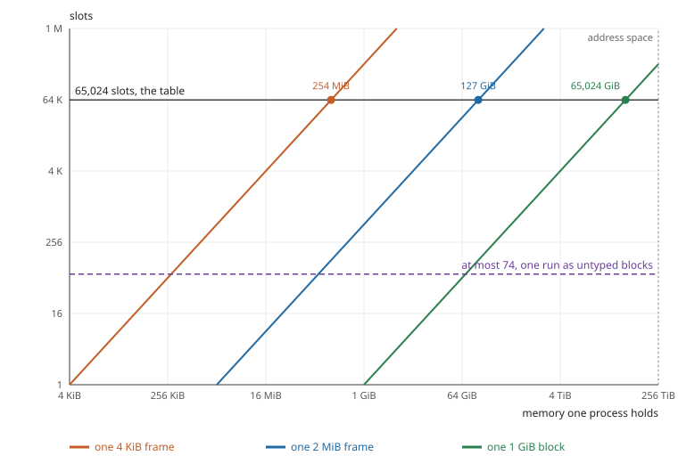

<!-- GENERATED by tools/faq.py from docs/faq/src/where-the-budget-runs-out.md. Do not hand-edit. -->

# Where a process's slot budget runs out

A process holds its capabilities in one table. The root has 512 entries (`ROOT_ENTRIES` in `kernel/verified/capability/table.rs`) and each leaf has 127 slots, one fewer than the nodes on its page (`NODES_PER_PAGE` in `kernel/verified/capability/list.rs`), because the leaf's first node is its hidden node. A full table holds 65,024 slots. The table starts with no leaf: the slots appear when a leaf is retyped, and no capability names the table. `design/process-holds-capabilities/`.

The limit binds when those slots are spent one to a piece of memory. A memory capability names one aligned block whose page count is a power of two, the power being the capability's order (`block_bytes` and `payload_wf` in `kernel/verified/capability/table.rs`). `design/capability-names-a-block/`.

A frame of one page is 4,096 bytes (`PAGE_SZ` in `kernel/verified/define.rs`). `can_retype_frame` in `kernel/verified/capability/retype.rs` allows it, and the `RETYPE_FRAME` arm of `allows_retype` in `kernel/verified/capability/operation.rs` is how a caller asks for it. A frame of 2,097,152 bytes has order 9 (`SIZE_2M` and `INDEX_BITS` in `kernel/verified/define.rs`). The `RETYPE_LARGE_FRAME` arm passes that order to `can_retype_large`, and the source writes the order as a literal. One slot per page over a full table reaches 266,338,304 bytes. One slot per frame of 2,097,152 bytes reaches 136,365,211,648 bytes. Each reach is the smaller of the table's slots times the block and the address space (`NODE_SPACE` in `kernel/verified/capability/list.rs`).

A block of 1,073,741,824 bytes has order 18, twice `INDEX_BITS` (`SIZE_1G` in `kernel/verified/define.rs`). `can_retype_large` allows order 9 or order 18, and the source writes both as literals. `can_free_frame` in `kernel/verified/capability/operation.rs` accepts both. `allows_retype` passes only order 9, so a caller cannot retype the larger block. `design/capability-names-a-block/` leaves a frame of that size until the page table maps one, and `design/syscall-abi-in-registers/` records that retype accepts no kind for it. The plot still draws the line. One slot per block of 1,073,741,824 bytes would reach 69,818,988,363,776 bytes, again the smaller of the table times the block and the address space.

An untyped takes any order up to `MAX_ORDER`, 36 (`kernel/verified/capability/table.rs`). A block of that order is the address space: 281,474,976,710,656 bytes, `NODE_SPACE` in `kernel/verified/capability/list.rs`, the end of the 48-bit space, and the same number as one page shifted left by `MAX_ORDER`. One such slot, based at the start of the space, covers it. A run lying inside the pages the block table tracks, decomposed at `MAX_ORDER`, has at most 74 blocks (`lemma_run_blocks` in `kernel/verified/capability/decompose.rs`). That is fewer than the table's 65,024 slots. `design/untyped-memory/` and `design/root-process-at-boot/`.

The diagonals are one capability per block of one size: the slots are the memory divided by the block. The upper horizontal line is the full table, 65,024 slots, and the dot on a diagonal is where that size reaches the table, or the address space when that comes first. The lower horizontal line is one run as untyped blocks, at most 74. The vertical line is the address space, 281,474,976,710,656 bytes. To the right of a dot that sits on the table's line, that process cannot hold the memory as separate blocks of that size. A larger block that retype does make, or an untyped block, still covers it, and one run stays within the untyped bound.
